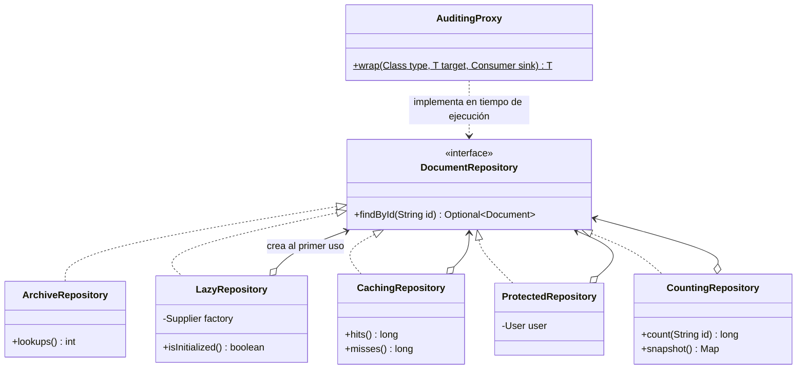

# Patrón Proxy en Java: virtual, caché, protección, referencia inteligente y proxy dinámico (Java 17+)

[](https://github.com/KevinAndrey96/java-proxy-design-pattern/actions/workflows/ci.yml)


[](LICENSE)

Implementación del **patrón estructural Proxy** (*Gang of Four*) en Java moderno. Cinco proxies distintos envuelven el mismo repositorio de documentos y se apilan en cualquier orden porque todos implementan una sola interfaz. Incluye una demo de consola en español, 27 pruebas con JUnit 6 y CI en Java 17, 21 y 25.

## Contenido

- [Qué resuelve el patrón](#qué-resuelve-el-patrón)
- [Uso](#uso)
- [Los cinco proxies](#los-cinco-proxies)
- [Diagrama](#diagrama)
- [Defectos de la versión de 2018 corregidos](#defectos-de-la-versión-de-2018-corregidos)
- [Estructura](#estructura)
- [Pruebas y calidad](#pruebas-y-calidad)
- [Historia del proyecto](#historia-del-proyecto)

## Qué resuelve el patrón

Un proxy es un objeto que se hace pasar por otro y controla el acceso a él. El cliente cree que habla con el repositorio real, pero en medio se puede diferir su creación, guardar respuestas, revisar permisos, contar accesos o registrar cada llamada, sin tocar el código del repositorio ni el del cliente.

## Uso

Requiere Java 17 o superior y Maven 3.9.

```bash
mvn verify
java -jar target/proxy-pattern.jar
```

```text
Usuario : lector (rol lector)
Cadena  : auditoría > protección > conteo > caché > carga diferida > archivo
Archivo creado antes de consultar: no

INF-2018   Informe anual 2018
NOM-2018   acceso denegado (confidencial)
INF-2018   Informe anual 2018
MAN-001    Manual de usuario
NO-EXISTE  no existe
INF-2018   Informe anual 2018

Archivo creado al final      : sí
Consultas de clientes        : 6
Consultas al archivo real    : 4
Aciertos de caché            : 2
Consultas por documento      : INF-2018=3, MAN-001=1, NO-EXISTE=1, NOM-2018=1

Auditoría (proxy dinámico):
  findById(INF-2018) -> Optional[Document[id=INF-2018, title=Informe anual 2018, classification=PUBLIC]]
  findById(NOM-2018) threw AccessDeniedException
  ...
```

Seis consultas de clientes llegan solo cuatro veces al archivo: las dos repeticiones de `INF-2018` salen de la caché. Con otro rol o con identificadores propios:

```bash
java -jar target/proxy-pattern.jar --rol auditor NOM-2018 NOM-2018
```

| Código de salida | Significado |
| :--- | :--- |
| `0` | Demo ejecutada |
| `2` | Argumentos inválidos (rol desconocido, `--rol` sin valor o identificador vacío) |

## Los cinco proxies

| Variante | Clase | Qué hace |
| :--- | :--- | :--- |
| Virtual | `LazyRepository` | Crea el repositorio real en la primera consulta, una sola vez aunque lleguen hilos concurrentes (doble verificación sobre un campo `volatile`). |
| Caché | `CachingRepository` | Guarda las últimas respuestas en una caché LRU acotada, incluidas las búsquedas sin resultado. |
| Protección | `ProtectedRepository` | Deja leer documentos públicos a cualquier usuario y reserva los confidenciales para el rol `AUDITOR`. |
| Referencia inteligente | `CountingRepository` | Cuenta cuántas veces se pide cada documento, lo que hacía la versión original con dos enteros. |
| Dinámico | `AuditingProxy` | Usa `java.lang.reflect.Proxy` para auditar cualquier interfaz con un solo `InvocationHandler`, sin escribir una clase por tipo. |

```java
DocumentRepository chain = AuditingProxy.wrap(
        DocumentRepository.class,
        new ProtectedRepository(
                new CountingRepository(
                        new CachingRepository(
                                new LazyRepository(ArchiveRepository::sample), 16)),
                user),
        log::add);
```

El orden importa: el conteo va antes de la caché para medir lo que piden los clientes, y la protección revisa cada respuesta, también las que vienen de la caché.

## Diagrama



## Defectos de la versión de 2018 corregidos

- `Proxy.toString()` concatenaba `this` dentro de sí mismo mientras el sujeto real no existía, y `obtenerSujetoReal()` también usaba `this` para nombrarlo: la primera consulta de estado o la primera llamada terminaban en `StackOverflowError`, así que la demo original no podía completarse.
- `toString()` imprimía en consola y devolvía una cadena vacía en lugar de describir el objeto.
- `Sujeto.status(Sujeto)` hacía un cast a `Proxy` y fallaba con `ClassCastException` al recibir un `SujetoReal`.
- El sujeto era una clase abstracta: un proxy no podía envolver a otro proxy de un tipo distinto ni a implementaciones ajenas.
- La carga diferida no era segura entre hilos y los contadores estaban fijos a dos métodos.

## Estructura

```text
src/main/java/com/kevinandrey/proxy/
├── DocumentRepository.java     sujeto: la interfaz común
├── ArchiveRepository.java      sujeto real con contador de consultas
├── LazyRepository.java         proxy virtual
├── CachingRepository.java      proxy de caché LRU
├── ProtectedRepository.java    proxy de protección
├── CountingRepository.java     referencia inteligente
├── AuditingProxy.java          proxy dinámico con java.lang.reflect.Proxy
├── Document.java, Classification.java, User.java, Role.java
├── AccessDeniedException.java
└── cli/ProxyDemo.java          demo de consola en español
```

## Pruebas y calidad

- 27 pruebas con JUnit 6: cada proxy por separado, la cadena completa y la demo.
- La carga diferida se prueba con 32 hilos que llegan a la vez y deben crear el repositorio una sola vez.
- La caché se prueba con desalojo LRU y con búsquedas sin resultado.
- El proxy dinámico se prueba con resultados, excepciones relanzadas sin envolver y métodos de `Object`.
- El compilador corre con `-Xlint:all -Werror`.

GitHub Actions compila y prueba en Java 17, 21 y 25, y ejecuta una prueba de humo del JAR con los dos roles y un rol inválido.

## Historia del proyecto

Ejercicio de mayo de 2018 del curso de patrones de diseño, hecho en NetBeans. El código original se conserva en la etiqueta [`v0.1-java-coursework-2018`](https://github.com/KevinAndrey96/java-proxy-design-pattern/tree/v0.1-java-coursework-2018); la configuración de NetBeans se purgó del historial. En 2026 se reescribió con cinco variantes del patrón, pruebas, Maven y CI.

## Autor

**Kevin Andrey Herrera Silva** · [GitHub](https://github.com/KevinAndrey96)

## Licencia

[MIT](LICENSE) © 2018-2026 Kevin Andrey Herrera Silva
