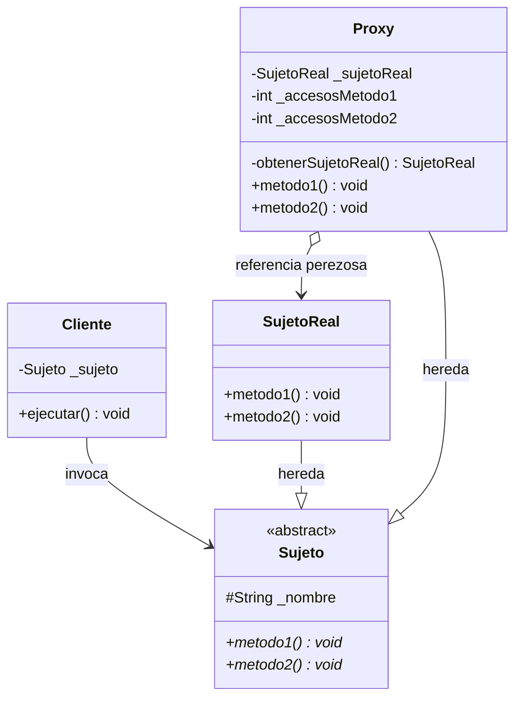

# Patrón de Diseño Proxy en Java (GoF Structural Pattern)

[](https://www.oracle.com/java/)
[](https://en.wikipedia.org/wiki/Proxy_pattern)
[](LICENSE)

Guía didáctica y arquitectura de referencia para la implementación del **Patrón Estructural Proxy** (*Gang of Four - GoF*) en **Java**.

El patrón **Proxy** proporciona un objeto sustituto o intermediario que controla el acceso a otro objeto (el *Sujeto Real*), permitiendo ejecutar acciones antes o después de delegar la solicitud, tales como inicialización bajo demanda (*Lazy Loading*), auditoría y conteo de accesos, control de permisos o interceptación de llamadas.

---

## 🏛️ Diagrama de Clases UML



---

## 🔍 Variantes del Patrón Proxy

Este repositorio implementa una combinación de dos variantes clave del patrón:

1. **Proxy Virtual (*Lazy Initialization / Carga Perezosa*):**
   * El `SujetoReal` no se instancia al momento de crear el `Proxy`.
   * La instanciación pesada del recurso se pospone hasta el momento exacto en que el cliente invoca un método por primera vez a través del método interno `obtenerSujetoReal()`.
2. **Referencia Inteligente (*Smart Reference / Conteo de Accesos*):**
   * El proxy mantiene contadores de uso (`_accesosMetodo1`, `_accesosMetodo2`) cada vez que un método es interceptado, permitiendo auditar el tráfico hacia el objeto real sin modificar su implementación.

Otras variantes comunes en la industria:
* **Proxy de Protección (*Protection Proxy*):** Verifica si el consumidor tiene los privilegios necesarios antes de permitir la invocación.
* **Proxy Remoto (*Remote Proxy*):** Representa un objeto que reside en un espacio de direcciones o servidor diferente (e.g. gRPC stubs, RMI).

---

## 📂 Estructura del Código

```
src/Proxy/
├── Sujeto.java        # Clase abstracta que define la interfaz común
├── SujetoReal.java    # Implementación concreta del servicio principal
├── Proxy.java         # Intermediario con inicialización perezosa y contadores
├── Cliente.java       # Consumidor desacoplado que depende de la abstracción Sujeto
└── Main.java          # Punto de entrada que ilustra la invocación polimórfica
```

---

## ⚙️ Compilación y Ejecución

Para compilar y ejecutar directamente desde la terminal con el JDK estándar:

```bash
# 1. Compilar los archivos Java
javac -d bin src/Proxy/*.java

# 2. Ejecutar la clase principal
java -cp bin Proxy.Main
```

### Salida esperada en consola:
```text
Ejecutando metodo1 en objetoA (Real)
Ejecutando metodo1 en objetoA (Real)
Ejecutando metodo2 en objetoA (Real)
Ejecutando metodo1 en objetoA (Real)
Ejecutando metodo1 en objetoB
Ejecutando metodo1 en objetoB
Ejecutando metodo2 en objetoB
Ejecutando metodo1 en objetoB
```

---

## 🚀 Aplicaciones en la Industria

* **Hibernate / JPA:** Las asociaciones `FetchType.LAZY` devuelven instancias proxy que interceptan las llamadas a los *getters* para cargar entidades desde la base de datos únicamente cuando se consultan.
* **Spring Framework:** Los aspectos AOP (`@Transactional`, `@Secured`, `@Cacheable`) envuelven los beans en proxies dinámicos de Java (`java.lang.reflect.Proxy` o CGLIB) para manejar transacciones y seguridad.
* **Sistemas Distribuidos:** Reverse proxies como NGINX o Envoy actúan como el equivalente a nivel de red, gestionando SSL termination, balanceo de carga y rate limiting antes de llegar a los microservicios backend.

---

## 📄 Licencia
Este proyecto es de código abierto bajo licencia [MIT](LICENSE).

**Autor:** [Kevin Andrey Herrera Silva](https://github.com/KevinAndrey96) · Bogotá, Colombia
